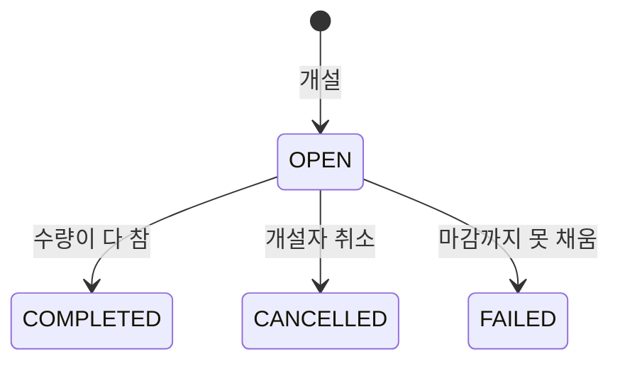

# 캠공

기숙사생끼리 물건을 같이 사는 **공동구매 플랫폼**. 박스 단위로 파는 물건을 여럿이 수량으로 나눠 가진다.

> **상태**: 설계 단계. 코드는 아직 없고, 요구사항·설계 문서를 먼저 닫는 중이다. 진행 상황은 [docs/design-plan.md](docs/design-plan.md)에 있다.

## 풀려는 문제

지금 기숙사 공구는 에브리타임 글과 지인 연락으로 돌아간다.

- 누가 몇 개를 잡았는지 개설자가 댓글을 보며 **손으로 센다**.
- 같은 순간에 댓글을 단 사람 중 누가 자리를 잡았는지 **불투명**하다.
- 입금과 수령 확인이 DM에 **흩어져** 있어 누가 냈는지 헷갈린다.
- 지난 공구의 기록이 남지 않는다.

<!-- TODO(사용자): 지인 3~5명에게 확인한 수요 결과를 한 줄로 적기 (design-plan 단계 0). 기존 서비스(예: 당근 '같이사요')와의 차이도 한 줄. -->

## 어떻게 풀까

공구 하나는 **상품 한 종류**를 가진다. 총 수량을 참여자들이 수량 단위로 나눠 가진다.

> 햇반 24개 한 박스 → 개설자 9개, 참여자 A 9개, 참여자 B 6개. 24개가 다 차는 순간 모집이 끝난다.

- 수량이 다 차면 마감을 기다리지 않고 바로 **모집 완료**. 마감까지 못 채우면 **모집 실패**로 자동 확정한다.
- 결제는 서비스 밖에서 한다. 서비스는 돈을 다루지 않고, 개설자가 입금·수령을 **체크표**로 기록한다.
- 참여자끼리의 소통은 개설자가 올린 **오픈채팅 링크**로 한다(모집 완료 후 참여자에게만 공개).

## 기능

| 번호 | 기능 | 한 줄 |
|------|------|-------|
| 001 | 공구 개설·수정·취소 | 상품, 수량, 마감, 구매처·오픈채팅 링크로 공구를 연다 |
| 002 | 가입·로그인 | 학교 이메일 인증으로 기숙사생만 |
| 003 | 목록·상세 조회 | 상태·카테고리 필터, 검색, '더 보기' |
| 004 | 참여·수량 변경·참여 취소 | 마지막 남은 수량 경쟁 |
| 005 | 마감 확정 | 마감 지난 미충족 공구를 자동으로 모집 실패 처리 |
| 006 | 개설자 체크 | 참여자별 입금·수령 체크표 |
| 007 | 알림 | 모집 완료·실패·수정·취소를 앱 안 알림함으로 |

결제 연동, 앱 안 채팅, 이메일·푸시 알림은 MVP에 넣지 않았다.

## 기술 포인트

이 프로젝트는 아래 세 가지를 직접 풀고 **수치로 설명하는 것**이 목적이다([헌법](.specify/memory/constitution.md)).

| 주제 | 내용 | 설계 |
|------|------|------|
| **동시성** | 마지막 남은 수량을 100명이 동시에 요청해도 초과·중복 없이 정확히 | 락 없음 / 비관적 / 낙관적 / 조건부 UPDATE 4방식을 같은 시나리오로 구현해 k6로 비교 ([004 plan](specs/004-participate-groupbuy/plan.md)) |
| **N+1** | 공구 → 참여 → 회원 조회에서 쿼리 수가 데이터 양에 비례하지 않게 | 순진한 구현의 쿼리 수를 먼저 재고 fetch join → batch size → DTO 프로젝션으로 개선하며 전후를 기록 ([003 plan](specs/003-browse-groupbuy/plan.md)) |
| **스케줄러 중복 실행 방지** | 서버가 여러 대여도 같은 공구를 한 번만 마감 확정 | 행 락 + `SKIP LOCKED`, 공구 1건씩 트랜잭션 ([005 plan](specs/005-close-groupbuy/plan.md)) |

측정 결과는 구현 후 `docs/benchmarks/`에 쌓는다. 설계가 기대는 DB 동작은 임시 코드로 먼저 검증했다([docs/spikes.md](docs/spikes.md)).

## 기술 스택

Java 21, Spring Boot, MySQL 8.4, Testcontainers(운영과 같은 MySQL로 통합 테스트), k6(부하 측정). 프론트엔드는 모바일 우선 웹이다.

## 개발 방식

[GitHub Spec Kit](https://github.com/github/spec-kit)으로 `constitution → specify → clarify → plan → tasks`까지 문서를 먼저 만든다.
구현 단계의 락·쿼리 같은 핵심 로직은 직접 쓰고, 설계 결정마다 대안과 이유를 `research.md`에 남겨 설명할 수 있게 한다.

## 문서 지도

| 문서 | 내용 |
|------|------|
| [docs/design-plan.md](docs/design-plan.md) | 설계 마무리 계획, 결정 기록, 진행 상태 |
| [docs/architecture.md](docs/architecture.md) | 스택, 패키지 구조, 공통 규약 |
| [docs/domain.md](docs/domain.md) | 용어집, 상태 변화, 불변식, ERD |
| [docs/screens.md](docs/screens.md) | 화면 목록, 화면-API 대조, 결정 기록 |
| [docs/cross-check.md](docs/cross-check.md) | 기능 간 교차 점검 결과 |
| [docs/spikes.md](docs/spikes.md) | 가정 검증 스파이크 결과 |
| [specs/](specs/) | 기능별 spec, plan, 데이터 모델, API 계약, 검증 시나리오 |
| [.specify/memory/constitution.md](.specify/memory/constitution.md) | 프로젝트 원칙 |

## 실행

구현 전이라 아직 실행할 것이 없다. 구현이 시작되면 로컬 실행과 테스트 방법을 여기에 적는다.
