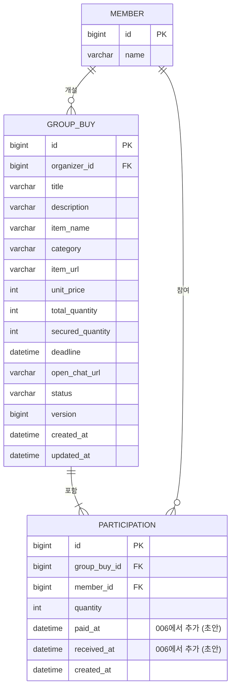
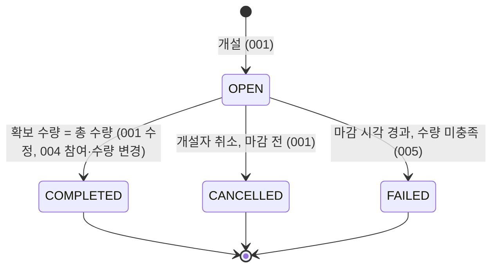

# 도메인 (초안)

**작성**: 2026-10-26 | **상태**: 확정(2026-10-26). 003~007의 **(초안)** 규칙은 각 기능 spec에서 확정한다 | **관련**: [architecture.md](architecture.md), 001 [spec](../specs/001-create-groupbuy/spec.md)

001 spec에서 확정된 것은 그대로 옮기고, 아직 spec이 없는 기능(003~007)의 규칙은 **(초안)**으로 표시한다. 초안은 각 기능 spec에서 확정한다.

## 1. 용어집

같은 개념에는 아래 이름만 쓴다. 오른쪽은 쓰지 않는 말이다.

| 용어 | 코드 이름 | 뜻 | 쓰지 않는 말 |
|------|-----------|----|--------------|
| 공구 | `GroupBuy` | 개설자가 연 공동구매 한 건. 상품 종류는 하나 | 게시글, 모집글 |
| 개설자 | `organizer` | 공구를 연 회원 | 호스트, 방장 |
| 참여 | `Participation` | 한 회원이 한 공구에서 가져가기로 한 수량 기록 | 신청, 주문 |
| 총 수량 | `totalQuantity` | 이번 공구에서 채울 전체 수량(예: 24개) | 정원 |
| 확보 수량 | `securedQuantity` | 모든 참여 수량의 합 | 참여 인원, 현재 수량 |
| 남은 수량 | `remainingQuantity` | 총 수량 − 확보 수량 | |
| 개당 가격 | `unitPrice` | 상품 하나의 가격(원) | 단가 |
| 마감 시각 | `deadline` | 이 시각까지 총 수량을 못 채우면 실패 | |
| 카테고리 | `category` | 상품 종류. 고정 6개: 식품(`FOOD`), 생활용품(`DAILY`), 주방(`KITCHEN`), 건강·뷰티(`HEALTH_BEAUTY`), 문구·학용품(`STATIONERY`), 기타(`ETC`) | 태그, 분류 |
| 구매처 링크 | `itemUrl` | 상품을 볼 수 있는 외부 링크 | 상품 링크 |
| 오픈채팅 링크 | `openChatUrl` | 참여자끼리 소통하는 외부 채팅 링크 | 채팅방 |
| 모집 중 | `OPEN` | 참여를 받는 상태 | |
| 모집 완료 | `COMPLETED` | 수량이 다 차서 성공한 상태 | 성공 |
| 모집 실패 | `FAILED` | 마감까지 못 채운 상태 | 마감 |
| 취소됨 | `CANCELLED` | 개설자가 취소한 상태 | 삭제됨 |
| 수정 | | 개설자가 공구 내용을 고치는 것 | |
| 취소 | | 개설자가 공구를 접는 것 | |
| 참여 취소 | | 참여자가 자기 수량을 빼는 것(공구는 유지) | 탈퇴 |

## 2. 구조

`GroupBuy`가 애그리거트 루트이고 `Participation`은 그 일부다. 수량·상태의 모든 변경은 공구 행을 기준으로 직렬화된다.
`Member`는 별도다.

`create_guard`(중복 개설 방지)는 도메인 엔티티가 아닌 보조 테이블이라 위 그림에서 뺐다. 자세한 컬럼 규칙은 [data-model.md](../specs/001-create-groupbuy/data-model.md).

## 3. 상태 변화

| 전이 | 조건(가드) | 일으키는 기능 | 이벤트 | 비고 |
|------|------------|---------------|--------|------|
| → `OPEN` | 입력 규칙 통과 | 001 개설 | | 개설자가 자기 수량으로 자동 참여. 개설 시 확보 < 총 수량이라 바로 `COMPLETED`가 되지 않음 |
| `OPEN → COMPLETED` | 변경 후 확보 = 총 수량, 마감 전 | 001 수정, 004 참여·수량 변경 | `GroupBuyCompleted` | 한 번만 일어나야 함. 오픈채팅 링크가 참여자에게 공개됨 |
| `OPEN → CANCELLED` | 개설자, 마감 전 | 001 취소 | `GroupBuyCancelled` | 조회·참여 불가. 참여 행은 보존 |
| `OPEN → FAILED` | 마감 시각 ≤ 현재, 확보 < 총 수량 | 005 | `GroupBuyFailed` | 스케줄러. 중복 실행에도 한 번만 |
| 그 외 | 불가 | | | 종료 상태에서 나가는 전이 없음 |

**마감 경계 (D2 확정)**: 변경(수정, 취소, 참여, 참여 취소)은 `마감 시각 > 현재`일 때만 허용하고, `마감 시각 ≤ 현재`이면 거부한다. 마감 시각 정각은 이미 마감이다. 005는 같은 경계로 `OPEN`을 `FAILED`로 바꾼다.
마감 판정에 쓰는 시각은 요청을 처리하는 순간(공구 행을 잡은 뒤)의 시각이다(005 결정). 그래서 마지막 수량 참여와 마감 확정이 동시에 도착해도 한 공구가 두 결과를 갖지 않는다. 처리 시점이 마감 전이면 참여가 받아들여지고, 마감 후이면 참여는 거부되며 확정이 일어난다.

**마감이 지났지만 아직 처리 전인 `OPEN`**: 005가 돌기 전까지 짧게 존재할 수 있다. 이 구간에서도 모든 변경은 거부된다(위 경계 규칙). 화면은 '마감됨(확정 대기)'로 표시한다(screens.md G10).

## 4. 불변식

| # | 불변식 | 지키는 곳 | 검증 |
|---|--------|-----------|------|
| I1 | `securedQuantity = Σ Participation.quantity` | 수량을 바꾸는 모든 쓰기가 참여 행과 `secured_quantity`를 같은 트랜잭션에서 함께 갱신 | 통합 테스트 |
| I2 | `1 ≤ securedQuantity ≤ totalQuantity` | 서비스 검증(락 안) + DB `CHECK` | 통합 테스트, 스파이크로 CHECK 확인 |
| I3 | `COMPLETED`는 전환 시점에 확보 = 총 수량이고, 이후 확보 수량이 변하지 않는다 | `GroupBuy`의 상태 전이 메서드 한 곳 | 통합 테스트 |
| I4 | 개설자의 참여는 `OPEN`·`COMPLETED`에서 항상 있고 수량 ≥ 1. 개설자는 참여 취소를 할 수 없고 공구를 취소해야 한다 | 서비스 검증 | 통합 테스트 |
| I5 | 한 회원은 한 공구에 참여 행이 최대 하나 | DB `UNIQUE (group_buy_id, member_id)` | DB 제약 |
| I6 | 총 수량 2~1000, 개당 가격 1~1,000,000, 마감 ≤ 개설 시각 + 30일 | 서비스 검증 + DB `CHECK`(가격) | 통합 테스트 |
| I7 | 상태 전이는 `OPEN`에서만 일어난다 | `GroupBuy` 상태 전이 메서드 | 통합 테스트 |
| I8 | 오픈채팅 링크는 `COMPLETED`일 때 참여자(개설자 포함)에게만, 개설자에게는 `OPEN`에서도 보인다 | 조회 서비스 | 통합 테스트(001 T025) |
| I9 | 참여자 명단은 개설자에게만 공개된다 | 조회 서비스(003, 006) | 통합 테스트 (초안) |
| I10 | `FAILED`는 마감 시각이 지났고 확보 < 총 수량일 때만 | 005 | 통합 테스트 (초안) |

## 5. 기능별 규칙

### 5.1 확정 (001 spec)

개설, 수정, 취소는 [spec](../specs/001-create-groupbuy/spec.md)의 FR-001~FR-018을 따른다. 이 문서는 반복하지 않는다.

### 5.2 참여 (004, 확정)

| 동작 | 누가 | 조건 | 효과 |
|------|------|------|------|
| 참여 | 개설자가 아닌 로그인 회원 | `OPEN`, 마감 전(처리 시각 기준), 사용자가 확인한 개당 가격이 현재와 같음, `1 ≤ 수량 ≤ 남은 수량`. 이미 참여했으면 수량이 같을 때만 변화 없이 성공(재시도), 다르면 거부 | 참여 행 생성, 확보 += 수량. 확보 = 총 수량이면 `COMPLETED` |
| 참여 수량 변경 (G05) | 참여자 본인(개설자 제외) | `OPEN`, 마감 전, 개당 가격 확인, `1 ≤ 새 수량 ≤ 남은 수량 + 기존 수량` | 확보 += (새 수량 − 기존 수량). 확보 = 총 수량이면 `COMPLETED` |
| 참여 취소 | 참여자 본인(개설자 제외) | `OPEN`, 마감 전 | 참여 행 제거(D3), 확보 −= 수량. 공구는 유지 |
| 개설자 수량 변경 | 개설자 | 001 수정(PUT)으로만 | 004의 수량 변경 API는 개설자에게 열지 않는다 |

`COMPLETED` 이후에는 참여, 수량 변경, 참여 취소가 모두 막힌다(모집 완료 시 확정).

### 5.3 마감 확정 (005, 확정)

- 30초마다 `status = OPEN`이고 `마감 시각 + 1초 ≤ 현재`(시계 오차 여유)인 공구를 찾아 1건씩 `SKIP LOCKED`로 선점하고 `FAILED`로 바꾸고 `GroupBuyFailed`를 발행한다. 확보 = 총 수량인 공구는 이미 `COMPLETED`라 대상이 아니다.
- 인스턴스가 여러 개여도 같은 공구를 두 번 처리하지 않는다(헌법 IV의 스케줄러 중복 방지).

### 5.4 조회 (003, 확정)

- 목록: 비로그인 허용, `CANCELLED`는 제외. 정렬·필터·페이지네이션은 003 plan에서 정한다.
- 상세: 로그인 필수. 개설자 이름, 내 참여 수량·금액, 참여 인원 수를 포함한다(screens.md G02).
- 참여자 명단: 개설자에게만(G07).

### 5.5 개설자 체크 (006, 초안)

- 개설자만 참여자별 입금·수령 여부를 표시한다. `Participation`에 `paid_at`, `received_at`을 추가한다.
- 입금·수령 체크는 `COMPLETED` 이후에만 의미가 있다.

## 6. 이벤트 카탈로그

| 이벤트 | 발행 | 대상 | 소비 |
|--------|------|------|------|
| `GroupBuyChanged` | 001 수정 | 개설자 외 참여자 | 007 |
| `GroupBuyCancelled` | 001 취소 | 개설자 외 참여자 | 007 |
| `GroupBuyCompleted` | 001 수정, 004 | 개설자를 포함한 모든 참여자 (D5) | 007 |
| `GroupBuyFailed` | 005 | 개설자를 포함한 모든 참여자 (D5) | 007 |

## 7. 결정 기록 (2026-10-26)

| # | 결정 | 영향 |
|---|------|------|
| D1 | 마감 실패 상태 이름은 `FAILED` | 005 |
| D2 | 마감 시각 정각은 이미 마감이다. `마감 시각 ≤ 현재`면 변경 불가, 005는 같은 경계로 `FAILED` 처리 | 001(이미 `deadline > now`로 일치), 004, 005 |
| D3 | 참여 취소 시 참여 행을 지운다. 이력이 필요해지면 그때 추가한다 | 004 |
| D4 | 개설자 수량 변경은 001 수정(PUT)으로만 한다. 004 수량 변경은 개설자에게 열지 않는다 | 001, 004 |
| D5 | 모집 완료·실패 알림은 개설자를 포함한 전원에게 보낸다 | 007 |
| D6 | 취소된 공구는 '내 활동'에도 보이지 않는다. 취소 사실은 알림으로만 전한다 | 003, 007 |
