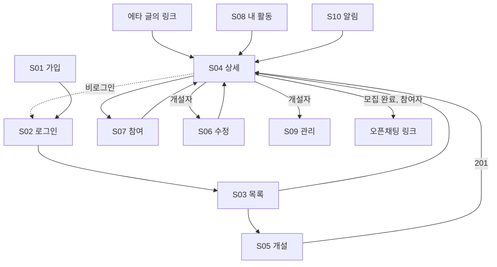

# 화면 흐름과 빈 칸 점검 (초안)

**작성**: 2026-10-26 | **상태**: 초안, 사용자 검토 전

**목적**: 화면을 먼저 그려서 spec·API에서 빠진 것을 찾는다. 프론트 기술 스택은 정하지 않는다(4단계).
**가정**: 기숙사생이 에브리타임 글의 링크를 휴대폰으로 열어 들어오므로 **모바일 우선 웹**이다. (확정 아님)
**범위**: MVP 후보 — 공구 개설, 참여/취소, 목록·상세, 마감 확정+알림, 개설자용 참여자·입금·수령 체크. 결제 연동 제외.

---

## 1. 화면 목록

| ID | 화면 | 누가 | 핵심 데이터 | 주요 액션 → API | 기능 |
|----|------|------|-------------|------------------|------|
| S01 | 가입 | 비회원 | 학교 이메일만 → 인증 메일 안내·재발송. 메일 링크(`/verify?token=…`)를 열면 인증 화면에서 표시 이름·비밀번호·개인정보 동의를 입력해 제출(가입 완료·자동 로그인, 만료·이미 사용·잘못된 링크 안내). 2026-10-28 변경 B2: 계정 선점 방지로 신청 단계에는 이메일만 받는다 | 가입 신청, 인증 메일 재발송 | 로그인 기능 (002) |
| S02 | 로그인 | 비회원 | | 로그인 | 로그인 기능 (4단계) |
| S03 | 공구 목록 (홈) | 회원 | 카드: 제목, 상품명, 개당 가격, 진행률(확보/총), 마감까지 남은 시간, 상태 | 목록 조회, 정렬, 상태·카테고리 필터, 검색(제목·상품명), 카드 탭 → S04 | 조회 기능 |
| S04 | 공구 상세 | 회원 | 제목, 설명, 상품명, 구매처 링크, 개당 가격, 총·확보·남은 수량, 마감, 개설자 이름, 상태, 내 참여 수량·금액, (완료 후 참여자) 오픈채팅 링크 | 참여 → S07, 참여 취소, (개설자) 수정 → S06, 취소, 참여자 관리 → S09 | 001 GET + 조회·참여 |
| S05 | 공구 개설 | 회원 | 제목, 설명, 카테고리(필수), 상품명, 구매처 링크, 개당 가격, 총 수량, 마감 시각, 내 수량, 오픈채팅 링크(필수) | `POST /api/groupbuys`, 필드별 오류 표시 | **001 US1·US2** |
| S06 | 공구 수정 | 개설자 | S05와 같은 폼에 현재 값. 마감은 연장만, 총 수량은 확보 수량 이상 | `PUT /api/groupbuys/{id}` | **001 US3** |
| S07 | 참여 (수량 입력) | 회원 | 남은 수량, 개당 가격, 수량 입력, 내 금액 미리보기. 요청에 화면에서 확인한 개당 가격을 담고, 그 사이 바뀌었으면 바뀐 가격을 안내해 다시 확인시킨다(004) | 참여 | 참여 기능 |
| S08 | 내 활동 | 회원 | 탭: 내가 연 공구 / 내가 참여한 공구, 상태 뱃지 | 목록 조회 (내 것) | 조회 기능 |
| S09 | 개설자 관리 | 개설자 | 참여자별 이름, 수량, 금액, 입금 여부, 수령 여부 | 입금·수령 체크 | 개설자 체크 기능 |
| S10 | 알림 | 회원 | 수정·취소·모집 완료·실패 알림 | 알림 조회 | 알림 기능 (수단 미정) |

비로그인 사용자가 에타 링크로 S04에 들어오는 경우는 별도 화면이 아니라 **S04의 변형**으로 보고 G03에서 다룬다.

## 2. 화면 흐름



## 3. 상태 뱃지

| 표시 | 서버 상태 | 조건 | 비고 |
|------|-----------|------|------|
| 모집 중 | OPEN | 마감 전 | |
| 마감됨(확정 대기) | OPEN | 마감 지남, 아직 처리 전 | 실패 확정 기능이 생기기 전 임시 상태. G10 |
| 모집 완료 | COMPLETED | 수량이 다 참 | 오픈채팅 링크 공개 |
| 모집 실패 | (미정) | 마감까지 못 채움 | 별도 기능에서 상태 추가. 지금 enum에 없음 |
| 취소됨 | CANCELLED | 개설자 취소 | 목록·상세에서 안 보임 |

## 4. 주요 화면 스케치

**S03 목록 카드**

```text
┌────────────────────────────────┐
│ 햇반 24개 공구        [모집 중] │
│ 햇반 210g · 개당 1,200원        │
│ ████████░░░░░░░░  9 / 24개      │
│ 마감 11/1 18:00 (D-6)           │
└────────────────────────────────┘
```

**S04 상세 (참여자 시점 / 개설자 버튼은 괄호)**

```text
┌────────────────────────────────┐
│ ← 햇반 24개 공구      [모집 중] │
│ 햇반 210g · 개당 1,200원        │
│ ████████░░░░░░░░  9 / 24개      │
│ 남은 15개 · 마감 11/1 18:00     │
│ 구매처 링크 열기 →              │
│ 개설자 {이름}      ← G02        │
│ ─ 설명 ─                        │
│ ...                             │
│ 내 참여: 없음                   │
│ [ 참여하기 ]                    │
│ (개설자) [수정] [취소] [참여자 관리] │
│ (모집 완료 + 참여자) 오픈채팅 입장 →│
└────────────────────────────────┘
```

**S05 개설 폼**

```text
┌────────────────────────────────┐
│ 공구 열기                       │
│ 제목 [______________]  ≤100자   │
│ 설명 [______________]  선택     │
│ 상품명 [____________]  ≤100자   │
│ 구매처 링크 [https://...] 필수   │
│ 개당 가격 [_______]원  1~1,000,000│
│ 총 수량 [___]개        2~1000   │
│ 내 수량 [___]개        1~총수량-1│
│ 마감 [2026-11-01 18:00] ≤30일   │
│ 오픈채팅 링크 [https://...] 필수 │
│ 내 부담 금액: 10,800원 (미리보기) │
│ [ 열기 ]                        │
└────────────────────────────────┘
오류는 errors[].field 이름과 폼 필드를 1:1로 붙인다.
```

**S09 개설자 관리**

```text
참여자      수량   금액     입금   수령
홍길동      9     10,800   [✓]   [ ]
김철수      9     10,800   [ ]   [ ]
이영희      6      7,200   [✓]   [✓]
```

## 5. 필요한 API와 현재 계약(001) 대조

| 필요 | 현재 | 어디서 |
|------|------|--------|
| 가입, 인증 메일 확인, 로그인, 로그아웃 | ✅ | 002 |
| 공구 개설 `POST /api/groupbuys` | ✅ | 001 |
| 공구 수정 `PUT /api/groupbuys/{id}` | ✅ | 001 |
| 공구 취소 `POST /api/groupbuys/{id}/cancel` | ✅ | 001 |
| 공구 상세 `GET /api/groupbuys/{id}` | ✅ 003이 확장 (G02) | 003 |
| 공구 목록 (정렬, 필터, 검색, 더 보기) | ✅ | 003 (G01) |
| 내가 연/참여한 공구 | ✅ | 003 |
| 참여 (수량 입력) | ✅ | 004 |
| 참여 취소 | ✅ | 004 |
| 참여 수량 변경 | ✅ 허용 (G05) | 004 |
| 개설자용 참여자 목록 | ✅ 003 상세(명단) + 006 체크표 | 003 + 006 |
| 입금·수령 체크, 체크표 | ✅ | 006 |
| 알림 목록, 읽음, 읽지 않은 개수 | ✅ | 007 |

## 6. 놓친 것(빈 칸) 목록

**영향 큼**

| ID | 빈 칸 | 왜 문제인가 | 제안 |
|----|-------|-------------|------|
| G01 | 목록 API가 없다 | 홈 화면을 못 그린다. 정렬(최신, 마감 임박), 상태 필터, 페이지네이션 규칙도 없다 | 조회 기능으로 specify. N+1 소재의 출발점 |
| G02 | 상세 응답이 부족하다 | 화면에 필요한 개설자 이름, 내 참여 수량·금액, 참여 인원 수가 없고 `organizerId`뿐이다 | 조회 기능에서 확장. 001은 최소 조회로 유지 |
| G03 | 상세가 로그인 필수(401)인데, 에타 링크로 들어오는 비로그인 사용자는? | 홍보 채널이 링크 하나로 참여 집계인데 링크를 열자마자 막힌다 | **결정 필요**: 비로그인에게 상세를 읽기 전용으로 공개(링크·참여는 로그인 후) vs 로그인 후 원래 링크로 복귀 |
| G04 | 입금 방법을 안내할 곳이 없다 | 결제는 서비스 밖인데 참여자가 어디로 입금할지 알려줄 필드가 없다. 입금 체크 기능이 MVP에 있다 | **결정 필요**: 공구에 '입금 안내' 필드 추가(오픈채팅 링크처럼 모집 완료 후 참여자에게만 공개) vs 오픈채팅에서 안내 |
| G05 | 참여 수량을 바꿀 수 있는가? | 규칙은 "참여자 취소 = 그 사람 수량이 빠짐"뿐이다. 수량을 9에서 6으로 바꾸려면? | **결정 필요**: 취소 후 재참여 vs 수량 수정 허용 |
| G06 | 알림을 어디로 보내는가? | 001 이벤트는 만들지만 전달 수단이 없다. 앱 안 알림함이면 S10이 필요하고, 이메일이면 가입 시 받아야 한다 | 알림 기능 spec에서 결정 |

**영향 중간**

| ID | 빈 칸 | 제안 |
|----|-------|------|
| G07 | 참여자 명단을 누구에게 보여주는가 | 기본 제안: 인원 수·수량 합만 공개, 명단은 개설자에게만 |
| G08 | 상품 사진이나 구매처 링크가 없다 | 목록이 텍스트뿐이라 무슨 물건인지 알기 어렵다. 싼 대안: 구매처 URL 선택 필드 추가(001에 필드 하나). 이미지 업로드는 제외(저장소 필요) |
| G09 | 입금·수령 상태를 저장할 곳이 없다 | `participation`에 `paid_at`, `received_at` 추가는 개설자 체크 기능에서 |
| G10 | 마감이 지났지만 처리 전인 공구의 표시 | 실패 확정 기능이 생기기 전까지는 프론트가 `deadline < 현재`로 '마감됨(확정 대기)'를 표시 |
| G11 | 가입 정보와 기숙사생 확인 방식 | 대상이 기숙사생인데 어떻게 가려낼지 미정. 로그인 기능에서 결정 |

**영향 작음**

| ID | 빈 칸 | 제안 |
|----|-------|------|
| G12 | 폼 오류가 두 단계로 나온다 (형식 오류 → 교차 규칙 오류) | 서버가 한 번에 모아 주면 UX가 좋다. 분석 보고서 I2와 같은 건 |
| G13 | 시간 입력 | 사용자는 KST 입력, API는 오프셋 포함 ISO-8601. 변환은 프론트 책임이라고 계약에 적어두기 |
| G14 | 신고·차단·후기 | MVP 범위 밖 |

## 7. 결정 기록

| ID | 결정 | 일자 | 반영 위치 |
|----|------|------|-----------|
| G03 | 비로그인은 **목록(S03)만** 볼 수 있다. 상세·개설·참여 등 나머지는 로그인을 요구하고, 로그인하면 **메인화면(목록)으로 복귀**한다. 결과: 에타 링크로 들어온 사람은 로그인 후 목록에서 그 공구를 찾아야 한다. 불편하면 원래 링크로 복귀시키도록 바꾸는 비용은 작다 | 2026-10-26 | 조회 기능 spec(목록 API는 비로그인 허용), 로그인 기능. 001 상세 `GET`은 그대로 401 |
| G04 | 입금 방법은 **오픈채팅에서 안내**한다. 공구에 입금 안내 필드를 두지 않는다 | 2026-10-26 | 001 변경 없음. 오픈채팅 링크를 **필수**로 확정 |
| G05 | 참여 수량 **변경을 허용**한다 | 2026-10-26 | 참여 기능 spec. 수량을 늘려 딱 채우면 모집 완료(FR-016) |
| G08 | **구매처 링크 필드를 추가**한다. 쿠팡 등 상품 상세는 가져올 수 없으니 링크에 맡긴다 | 2026-10-26 | 001에 반영 완료: **필수**, https, 500자 이하 (FR-018) |
| 카테고리·검색 | 카테고리는 고정 6개(식품, 생활용품, 주방, 건강·뷰티, 문구·학용품, 기타)를 개설 때 필수 하나. 검색은 제목+상품명 부분 일치 | 2026-10-26 | 001 FR-019, 003 FR-017·018 |
| G07 | 참여자 명단은 **개설자에게만** 공개하고, 그 외에는 인원 수·수량 합만 보여준다. 공개는 나중에 풀기 쉽지만 비공개로 되돌리기는 어려워 좁게 시작한다 | 2026-10-26 | 조회 기능, 개설자 관리(S09) |
| G11 | 기숙사생 확인은 **학교 이메일 인증**(이메일+비밀번호 로그인, 표시 이름은 중복 불가). 학교 구성원임은 확인하지만 기숙사 거주 자체는 확인하지 못하는 한계가 있다 | 2026-10-26 | 002 |
| G06 | 알림 수단은 **앱 안 알림함**. 이메일·푸시는 후속. 앱을 열지 않으면 못 보는 한계 | 2026-10-26 | 007 |
